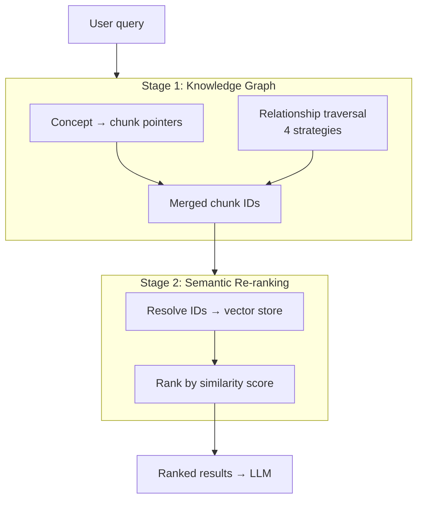

# When Adding Documents Broke My Search System

## How I learned that vector search alone isn't enough, and built a knowledge graph that finds what embeddings miss

---

I uploaded a 10,000-page medical textbook to my RAG system. The upload succeeded. The chunks were clean. The embeddings looked fine.

Then I searched for `allow_dangerous_code=True` — a LangChain parameter I knew was on page 114 of another document in my library.

It was gone. Not just ranked lower. Gone.

The new textbook's 10,000 chunks had shifted the vector index, pushing the correct page below the similarity threshold. My search system had become worse because I added more knowledge to it.

That was the moment I realized vector search has a blind spot that knowledge graphs don't.

---

### Table of Contents

1. [The problem with pure vector search](#the-problem-with-pure-vector-search)
2. [Why a knowledge graph sees what vectors miss](#why-a-knowledge-graph-sees-what-vectors-miss)
3. [The architecture: two-stage retrieval](#the-architecture-two-stage-retrieval)
4. [The knowledge graph at scale](#the-knowledge-graph-at-scale)
5. [Four strategies for traversing the graph](#four-strategies-for-traversing-the-graph)
6. [Making the graph explain itself](#making-the-graph-explain-itself)
7. [Three-layer NER: why one model isn't enough](#three-layer-ner-why-one-model-isnt-enough)
8. [Adaptive chunking with bridge generation](#adaptive-chunking-with-bridge-generation)
9. [Vision OCR: images aren't invisible content](#vision-ocr-images-arent-invisible-content)
10. [Conversations become knowledge](#conversations-become-knowledge)
11. [Production infrastructure](#production-infrastructure)
12. [What I'd tell someone building their own](#what-id-tell-someone-building-their-own)

---

## The problem with pure vector search

Vector embeddings compress meaning into fixed-dimensional numbers. They're remarkable, but they have a fundamental limitation: precise terms get diluted in the embedding space.

"allow_dangerous_code=True" isn't semantically rich. It's a code parameter. An embedding model can't distinguish it from general security content — it just sees another configuration string floating in a sea of medical terminology. When your index doubles in size overnight, strings like this drop below the similarity floor and never surface.

The worst part? You don't notice it happening. There's no error. No crash. Your system just silently returns worse results, and unless you happen to search for something you know should be there, you'll never catch it.

I caught it because I got lucky. But it made me ask: what else had gone missing?

---

## Why a knowledge graph sees what vectors miss

Here's the key difference. A vector index stores "this chunk is similar to this query." A knowledge graph stores "this concept came from this chunk." Those are fundamentally different things.

In my knowledge graph, `allow_dangerous_code=True` exists as a concept node with a direct `EXTRACTED_FROM` edge to chunk #4521 on page 114. That edge is structural — it doesn't drift when you add more content. It doesn't depend on similarity scores or embedding dimensions. The concept either came from that chunk, or it didn't.

No amount of index drift can break a pointer.

The fix wasn't to bolt keyword search onto the vector pipeline as a band-aid. It was to ensure the knowledge graph retrieval path completed within its timeout budget by running concept traversals concurrently instead of sequentially. At 7.1 million nodes, the difference between sequential and concurrent traversal is the difference between a timeout and a correct answer.

---

## The architecture: two-stage retrieval

The system I built — the Librarian — uses a two-stage pipeline:

**Stage 1: Knowledge graph retrieval.** The query gets decomposed into concepts, matched against a Neo4j fulltext index, and chunks are retrieved via those `EXTRACTED_FROM` pointers. This stage also traverses relationships to find chunks connected through clinical or conceptual edges — content that mentions related ideas but never uses the exact query terms.

**Stage 2: Semantic re-ranking.** Chunk IDs from Stage 1 get resolved against the vector store and re-ranked by semantic similarity. This gives you the precision of graph retrieval with the relevance ordering of vector search.

The pipeline, simplified:



Concurrent execution is critical here. When your graph has 7.1 million nodes and a query matches 15 concepts, running those traversals sequentially will timeout. Running them concurrently keeps total latency bounded by the slowest single query rather than the sum:

```python
# Each concept pair gets its own traversal, all run concurrently
tasks = [
    run_traversal(pair, timeout_budget)
    for pair in concept_pairs
]
results = await asyncio.gather(*tasks, return_exceptions=True)
# Timeout spent = max(single_query), not sum(all_queries)
```

---

## The knowledge graph at scale

The graph currently holds 7.1 million nodes and 35.3 million relationships. About 756,000 of those nodes are concepts extracted from documents. Another 183,000 are chunk nodes. And 11.9 million `EXTRACTED_FROM` edges connect each concept back to the specific chunks it came from.

But the graph isn't just extracted content. It's enriched with three external knowledge bases:

**Wikidata** (392,000 entities) provides entity disambiguation. When the system extracts "Chelsea" from a document, it needs to know whether that's a football club, a neighborhood in Manhattan, or a person — each connecting to different chunks, different contexts, different answers.

**ConceptNet** (1.8 million concepts, 3.4 million relationships) connects concepts across documents through semantic relationships. "Neural network" in a medical paper and "deep learning" in a computer science textbook get connected through shared semantic meaning even though they appear in entirely separate documents.

**UMLS** — the Unified Medical Language System — is the heavyweight. It adds 1.6 million clinical concepts, 2.4 million synonyms, and 13.9 million clinical relationships. This is what makes the system capable of clinical reasoning rather than just keyword matching.

---

## Four strategies for traversing the graph

For a given query, each concept pair runs through four traversal strategies concurrently:

**1. UMLS 1-hop.** Direct clinical relationships. The system maps document concepts to UMLS concepts via `SAME_AS` edges, then walks one step along `UMLS_REL` edges. "Polyuria" → "has manifestation" → "Diabetes Mellitus."

**2. UMLS 2-hop.** Two-step clinical paths through an intermediate concept. "metformin" → "may treat" → "Type 2 Diabetes" → "isa" → "Diabetes Mellitus." This finds reasoning chains that no single document explicitly states.

**3. Direct inter-concept edges.** Named relationships between concepts extracted from documents. When a sentence like "Hepatitis B causes liver failure" passes through the extraction pipeline, it produces a `CAUSES` edge from the Hepatitis B node to the Liver Failure node. The relationship exists as a typed edge in the graph: `(Hepatitis_B)-[:CAUSES]->(Liver_Failure)`.

**4. Shared-chunk co-occurrence.** Two query concepts that both link to the same chunk via `EXTRACTED_FROM` edges, with no direct relationship edge between them. Concepts are connected through the chunk, not through each other:

```cypher
MATCH (c1:Concept {id: $concept_1})-[:EXTRACTED_FROM]->(chunk:Chunk)
      <-[:EXTRACTED_FROM]-(c2:Concept {id: $concept_2})
RETURN chunk.id, chunk.text, chunk.document_title
LIMIT 10
```

Strategy 3 fires when the extraction pipeline explicitly created a relationship. Strategy 4 fires when two concepts independently point to the same chunk but no relationship edge exists between them — the author discussed them together without ever writing a causal statement.

This distinction matters enormously for clinical pattern recognition. Symptom clusters that suggest a diagnosis often aren't stated as explicit relationships in the text. The author doesn't write "polyuria causes diabetes mellitus." They describe the patient: excessive urination, unexplained thirst, elevated blood glucose. Strategy 4 captures the pattern regardless.

Only 35 clinically meaningful UMLS relationship types are used out of 13.9 million edges. The rest — qualifier edges, subheading metadata — get filtered out. Without this whitelist, the 2-hop traversal drowns in noise.

A single pre-check determines whether any matched concept has a UMLS bridge at all. For non-medical queries, both UMLS strategies skip entirely, preserving the timeout budget for the document-edge and co-occurrence strategies. The system adapts its budget to the query, not the other way around.

---

## Making the graph explain itself

Raw graph paths mean nothing to an LLM. When the traverser finds clinical reasoning paths for a query like *"Patient presents with polyuria, polydipsia, unexplained weight loss, and fasting blood glucose of 280 mg/dL. What is the diagnosis and first-line treatment?"*, it produces machine-readable annotations:

```
"metformin --[may_treat]--> Type 2 Diabetes --[isa]--> Diabetes Mellitus"
"Polyuria --[has_manifestation]--> Diabetes Mellitus"
```

These are precise, but they're useless as prompt text.

A `ChainSynthesizer` converts these path annotations into a human-readable clinical reasoning gloss:

```
Clinical reasoning paths found between query concepts:
- Diabetes Mellitus ↔ Polyuria: Polyuria presents with Diabetes Mellitus
- Diabetes Mellitus ↔ Metformin: metformin may treat Type 2 Diabetes, which is a type of Diabetes Mellitus
```

This gloss lands in the system prompt via a `KNOWLEDGE GRAPH INSIGHTS` slot — before the LLM reads any retrieved chunks. The model gets explicit clinical relationship context to reason from, not just documents to summarize. UMLS relationship types are mapped to readable phrases: `has_manifestation` → "presents with," `may_treat` → "may treat," `isa` → "is a type of."

This was the missing last mile. The traverser was collecting clinical paths. Nothing was reading them. Now those paths reach the LLM.

---

## Three-layer NER: why one model isn't enough

Generic named entity recognition models fragment medical terminology. spaCy's standard English model extracts "hepatitis," "B," and "surface" as three separate tokens instead of recognizing "hepatitis B surface antigen" as a single clinical entity.

That fragmentation cascades through the entire pipeline. The knowledge graph gets three weak concepts instead of one precise one. The retrieval misses. The LLM hallucinates.

The system runs three NER layers concurrently:

- **spaCy** (`en_core_web_sm`) for general proper nouns: people, places, organizations, dates
- **scispaCy** (`en_core_sci_sm`) for multi-word scientific terms: "hepatitis B," "surface antigen"
- **Custom UMLS linker** that batch-queries candidate n-grams against the 1.6 million UMLS concepts, returning the longest matching clinical terms

Results merge with a priority hierarchy: UMLS terms override shorter scispaCy terms when they fully contain them; scispaCy terms override shorter spaCy terms. Non-overlapping terms from all layers are preserved. Each layer degrades independently — if the scientific model fails to load, the other two still produce results.

---

## Adaptive chunking with bridge generation

Standard chunking breaks text at fixed intervals. Split a paragraph about drug interactions in half, and neither chunk makes sense alone. The problem isn't the split — it's that the split doesn't know what it's splitting.

The system profiles each document's domain using Wikidata entity classification and ConceptNet relationship patterns to determine content type (medical, legal, technical, narrative). Based on that profile, it generates domain-specific configurations: where to split, how large chunks should be, and what content must stay together.

After splitting, a gap analysis measures semantic distance, concept overlap, and cross-reference density between adjacent chunks. When the gap is significant, the system generates a bridge chunk using Llama 3.2 3B via Ollama — a short passage that preserves the conceptual thread between the two chunks. Each bridge is validated with cross-encoding models for semantic relevance and factual consistency. Failed bridges fall back to intelligent mechanical overlap with sentence-boundary awareness.

356,000 searchable chunks, each with preserved context and domain-aware boundaries.

---

## Vision OCR: images aren't invisible content

Medical textbooks are full of tables, diagrams, clinical photographs, and charts embedded as images. Standard PDF extraction ignores them. A scanned 109MB antimicrobial therapy guide produced one chunk from text extraction alone.

Every embedded image runs through Ollama vision models with content-aware routing: `minicpm-v:8b` for structured content like tables and forms, `llama3.2-vision:11b` for narrative content like diagrams and anatomical illustrations. The visual interpretation — description plus OCR of any text within the image — is combined with the page's native text into a unified stream before chunking.

Nothing stays invisible.

---

## Conversations become knowledge

Every Q&A thread gets chunked, embedded, and merged into the knowledge graph using the same pipeline as documents. Concepts extracted from conversations get the same `EXTRACTED_FROM` edges pointing to the conversation chunks they came from.

A question you asked last week about drug interactions becomes retrievable context for a related question today. The system treats all knowledge sources — textbooks, clinical guidelines, and conversations — with equal priority during search. Over time, it builds a memory of what your team has explored.

---

## Production infrastructure

The stack runs on Docker locally with seven services: Neo4j, Milvus, PostgreSQL, Redis, Celery workers, a dedicated ML model server, and the FastAPI application.

The ML model server lives in its own container so code changes don't require reloading 4GB of models. The app container starts in 5 seconds while embedding models, spaCy pipelines, and cross-encoders load asynchronously in the background.

Document processing is distributed across Celery workers with parallel bridge generation, knowledge graph extraction, and vector storage. A quality gate validates each stage — tracking LLM failure rates, NER failure rates, and bridge generation success rates — before marking a document complete.

Responses stream in real-time via WebSocket with clickable source citations. Every claim is backed by an interactive citation showing document title, page number, relevance score, and an excerpt from the source chunk. When library results are thin, the system supplements with web search via SearXNG and clearly labels the source type.

Relevance detection uses two signals: score distribution analysis identifies when results cluster at the semantic floor (everything scores similarly because nothing is truly relevant), and concept specificity analysis distinguishes domain-specific terms from generic words to assess whether the knowledge graph found meaningful matches. Confidence scores adjust downward for uncertain results so the LLM doesn't overstate its certainty.

Deployment to AWS uses Terraform with Neptune replacing Neo4j as the graph database, OpenSearch for vectors, ECS Fargate for containers, and CloudWatch for monitoring. The architecture is the same regardless of where it runs.

---

## What I'd tell someone building their own

After 80+ specs and everything that went wrong along the way, here's what I'd prioritize if I were starting over:

**1. Vector search is necessary but not sufficient.** Embeddings find similar things. Knowledge graphs find connected things. You need both. The graph provides a stable retrieval path that doesn't drift when your document library grows. Build the graph alongside the vector index from day one — retrofitting it later is much harder.

**2. Domain-specific NER is the difference between finding the answer and missing it entirely.** "Hepatitis B surface antigen" as one entity versus three fragments determines whether your retrieval pipeline works. Three concurrent NER layers with a merge hierarchy sounds like overengineering until you watch a medical query fail because your NER model doesn't know what "surface antigen" means.

**3. Concurrent execution isn't optional at scale.** When your knowledge graph has 7 million nodes and a query matches 15 concepts, sequential Neo4j traversals will timeout. Run them concurrently. An adaptive timeout budget — where each strategy gets allocated time from the remaining budget rather than a fixed equal slice — means the system degrades gracefully instead of hanging.

**4. Every document upload changes the retrieval landscape.** Adding 10,000 chunks from a new textbook shifts your vector index and can push previously retrievable content below the similarity threshold. The knowledge graph is immune to this drift. That's the argument for structural retrieval, not just the argument for having both.

**5. Spec-driven development works.** Each feature started as a requirements document, progressed through design with formal correctness properties, and was implemented against a task list with property-based tests. This methodology caught bugs that unit tests missed and made the system's behavior verifiable across all valid inputs.

---

The Librarian is open source at [github.com/jeujai/Librarian](https://github.com/jeujai/Librarian). If you're building RAG systems, working in medical informatics, or pushing knowledge graphs beyond demos — I'd welcome the conversation.

---

*#RAG #KnowledgeGraph #NLP #MedicalAI #NER #VectorSearch #Python #Neo4j #LLM #MachineLearning #scispaCy #UMLS*
